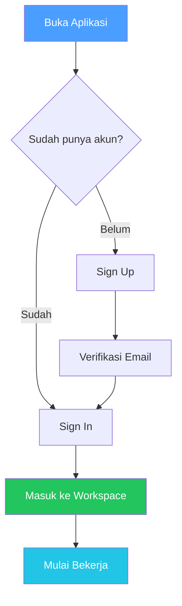

# Authentication

## Overview

Sistem autentikasi mengelola login, registrasi, dan keamanan akun kamu. Setelah login, kamu akan diarahkan ke workspace yang sesuai dengan peran kamu.

## Siapa yang Butuh Ini?

Semua pengguna harus memahami halaman ini. Khususnya:
- **User baru** — untuk membuat akun dan login pertama kali
- **User yang lupa password** — untuk reset password
- **Admin** — untuk mengelola token akses eksternal

## Cara Kerja Autentikasi

## Sign In

1. Buka halaman login
2. Masukkan **email** dan **password** kamu
3. Klik **Sign In**

Kamu tetap login selama 7 hari. Sistem memperbarui sesi secara otomatis.

## Sign Up

1. Klik **Sign Up** di halaman login
2. Isi **nama**, **email**, dan **password**
3. Klik **Create Account**
4. Buka email dan klik **link verifikasi**
5. Setelah terverifikasi, kamu bisa login

## Forgot Password

1. Di halaman login, klik **Forgot Password**
2. Masukkan email kamu
3. Buka email dan klik **link reset**
4. Masukkan password baru
5. Login dengan password baru

> **Catatan:** Semua sesi lain akan logout saat kamu reset password.

## Security Features

| Fitur | Penjelasan |
|-------|-----------|
| Password hashing | Password tidak pernah disimpan dalam bentuk plain text |
| Session refresh | Sesi diperbarui secara otomatis |
| Token rotation | Refresh token berubah setiap kali digunakan |
| Stolen token detection | Jika token lama digunakan lagi, semua sesi dihapus |
| Email enumeration prevention | Pesan yang sama untuk email yang ada dan tidak ada |

## Tips

- Gunakan password yang kuat (minimal 8 karakter, kombinasi huruf, angka, simbol)
- Jangan bagikan password kamu dengan siapapun
- Jika curiga akun kamu diretas, segera reset password

## Kesalahan Umum

| Masalah | Solusi |
|---------|--------|
| Lupa password | Klik "Forgot Password" di halaman login |
| Email verifikasi tidak sampai | Cek folder spam, atau minta kirim ulang |
| Login gagal terus | Pastikan email dan password benar, lalu coba lagi |
| Sesi expired | Login ulang — normal setelah 7 hari tidak aktif |

## Langkah Selanjutnya

Setelah berhasil login, kamu akan melihat [Dashboard](../features/dashboard.md). Dari sana, mulai dengan:
- [Impor Repository](../features/repositories.md) untuk menghubungkan kode kamu
- [Jalankan Scan Pertama](../features/scans.md) untuk memulai pemindaian
