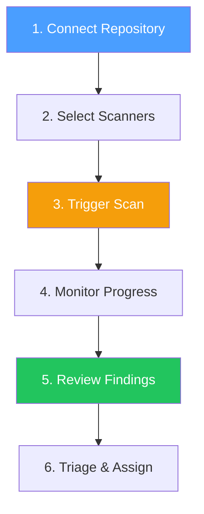
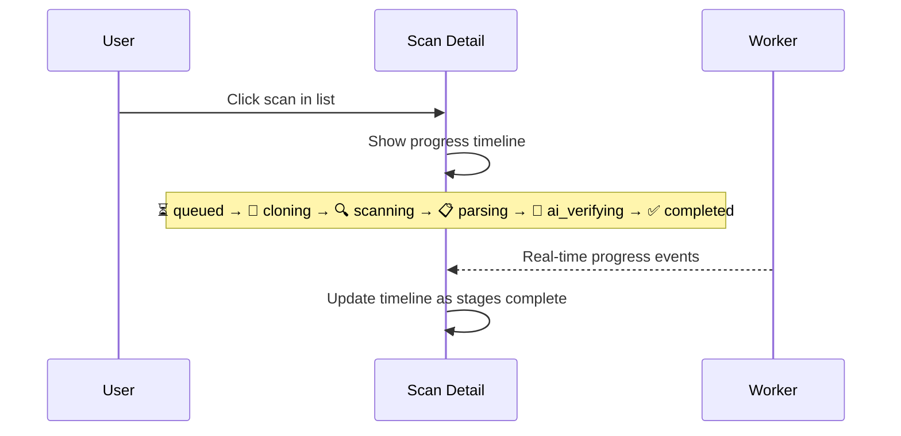

# First Scan

Run your first security scan in 5 minutes.

## Prerequisites

1. SAST Integration running ([Installation](installation.md))
2. A user account with workspace access
3. A source control provider connected (optional — can scan manually)

## Quick Scan Flow



## Step 1: Connect a Repository

### Option A: Via Source Control (Recommended)

1. Navigate to **Configure → Source Control** in the sidebar
2. Click **Connect Provider** (GitHub / GitLab / Gitea)
3. Authorize the OAuth flow
4. Wait for repository sync
5. Go to **Repositories** → Click **Import** on a repository
6. Assign to a project (or create new)

### Option B: Manual Repository

If you don't use SCM integration:

1. Go to **Repositories** in the sidebar
2. Click **Add Repository**
3. Enter repository URL, name, and default branch
4. The repository will be scanned via CI/CD upload

## Step 2: Trigger a Scan

1. Go to **Scans** in the sidebar
2. Click **New Scan**
3. Select repository and branch
4. Choose scanner engines:

| Scanner | Languages | When to Use |
|---------|-----------|-------------|
| **Semgrep** | 30+ languages | Always recommended — comprehensive SAST |
| **Gitleaks** | All | Always recommended — secret detection |
| **Flawfinder** | C/C++ | C/C++ codebases |
| **Cppcheck** | C/C++ | C/C++ codebases |
| **Clang-Tidy** | C/C++ | C/C++ with build system |
| **GCC FanAnalyzer** | C/C++ | GCC-compiled C/C++ |

5. Click **Start Scan**

## Step 3: Monitor Progress



Scan stages:

| Stage | Description | Duration |
|-------|-------------|----------|
| `queued` | Waiting for worker pickup | Seconds |
| `cloning` | Git clone in progress | 10-30s |
| `scanning` | Scanners executing in parallel | 30s-5min |
| `parsing` | Output parsed into structured findings | 5-15s |
| `ai_verifying` | AI models verifying each finding | 1-10min |
| `completed` | Scan finished successfully | — |

## Step 4: Review Findings

1. Go to **Findings** in the sidebar
2. Use filters to narrow down:
   - **Severity**: Critical / High / Medium / Low / Info
   - **Status**: Open / Dismissed / Resolved
   - **Scanner**: Semgrep / Gitleaks / etc.
   - **Repository**: Filter by specific repo
3. Click a finding to view details:
   - Source code snippet with line highlighting
   - AI verdict (True Positive / False Positive / Pending)
   - Confidence score (0-100%)
   - CWE classification
   - Remediation suggestion
   - Finding history (changes over time)

## Step 5: Triage Findings

| Action | Description |
|--------|-------------|
| **Resolve** | Mark as fixed in code |
| **Dismiss** | Mark as false positive |
| **Re-verify** | Request AI re-verification with updated context |
| **Assign** | Assign to team member for review |
| **Bulk actions** | Select multiple findings for batch operations |

## CI/CD Integration

For automated scanning in pipelines:

```bash
# 1. Create a Project API Token
#    Go to Project Settings → API Tokens → Create

# 2. Initialize scan
curl -X POST https://your-domain.com/api/v1/scans/upload/init \
  -H "Authorization: Bearer <project-api-token>" \
  -H "Content-Type: application/json" \
  -d '{"repositoryName":"my-repo","branch":"main","commitSha":"abc123"}'

# 3. Upload scanner results
curl -X POST https://your-domain.com/api/v1/scans/upload \
  -H "Authorization: Bearer <project-api-token>" \
  -F "scanId=<scan-uuid>" \
  -F "scanner=semgrep" \
  -F "file=@semgrep-results.json"

# 4. Complete scan
curl -X POST https://your-domain.com/api/v1/scans/upload/complete \
  -H "Authorization: Bearer <project-api-token>" \
  -H "Content-Type: application/json" \
  -d '{"scanId":"<scan-uuid>","status":"completed"}'
```

### GitHub Actions Example

```yaml
name: SAST Scan
on: [push, pull_request]

jobs:
  scan:
    runs-on: ubuntu-latest
    steps:
      - uses: actions/checkout@v4
      - name: Run Semgrep
        uses: returntocorp/semgrep-action@v1
        with:
          config: p/default
      - name: Upload to SAST
        run: |
          curl -X POST $SAST_URL/api/v1/scans/upload/init \
            -H "Authorization: Bearer $SAST_TOKEN" \
            -d '{"repositoryName":"'$GITHUB_REPOSITORY'","branch":"'$GITHUB_REF_NAME'","commitSha":"'$GITHUB_SHA'"}'
```
