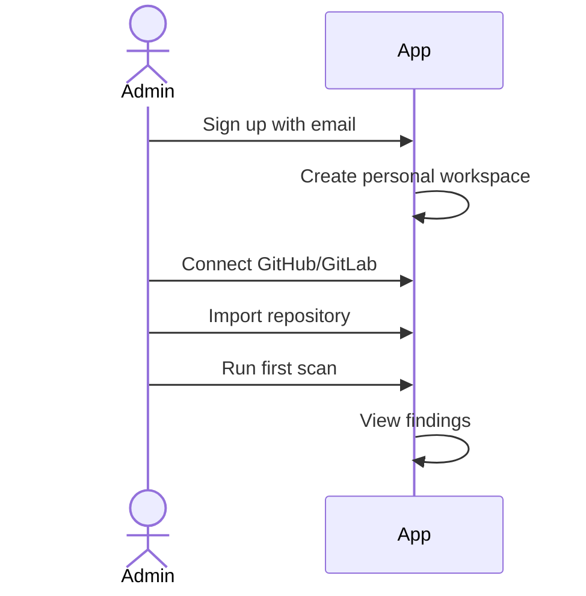
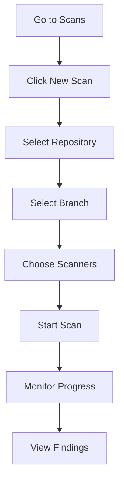
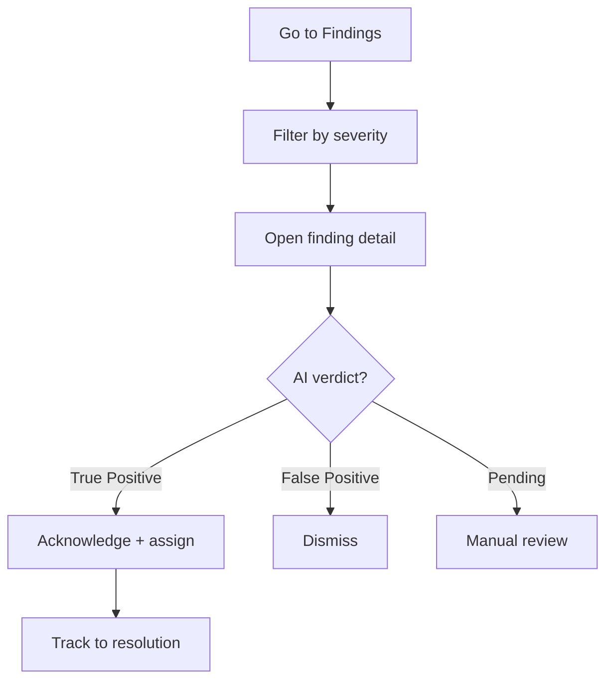
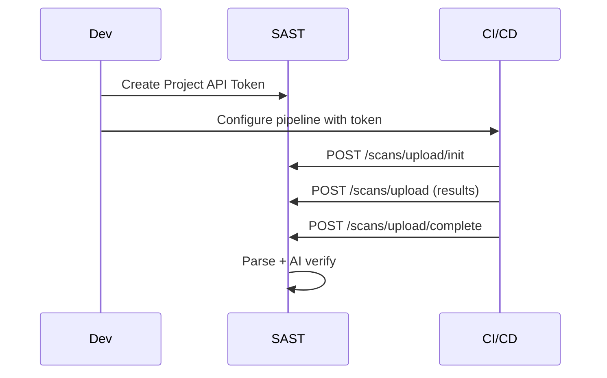
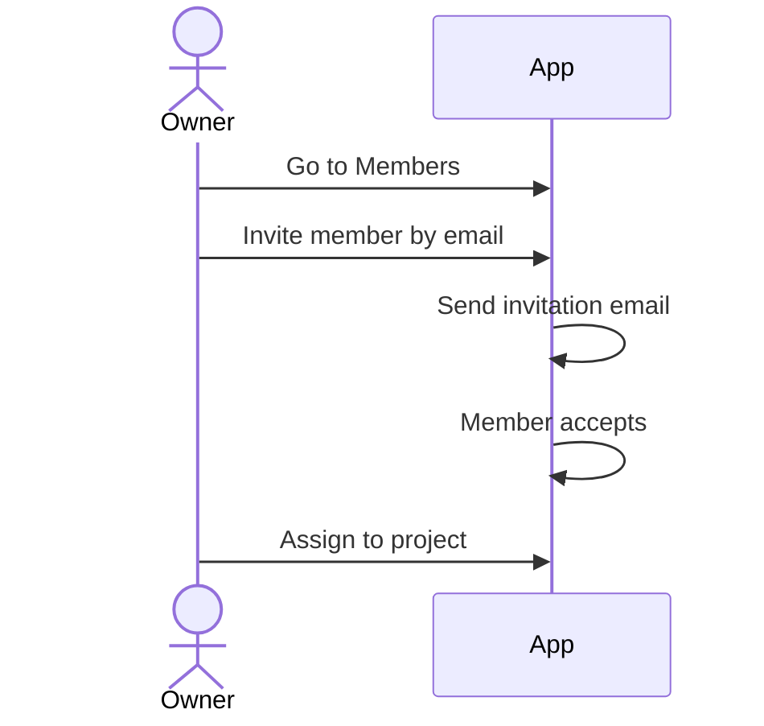
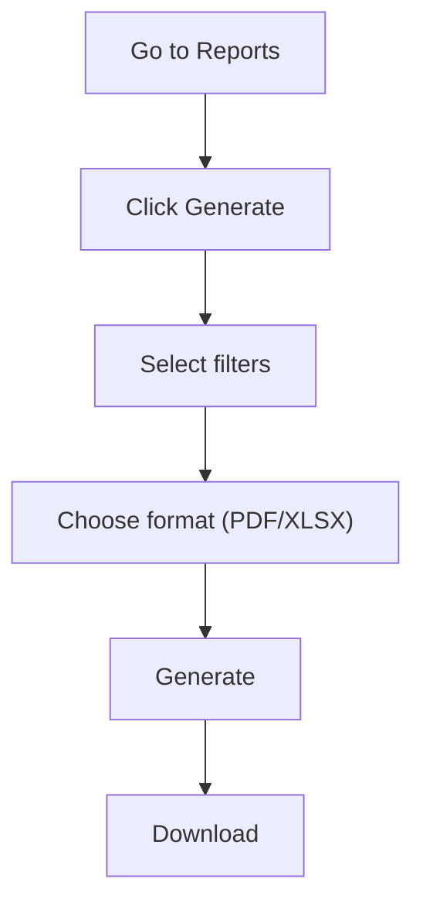

# User Interaction Scenarios

## Scenario 1: First-Time Setup

## Scenario 2: Run a Scan

## Scenario 3: Triage Findings

## Scenario 4: Set Up CI/CD

## Scenario 5: Invite Team

## Scenario 6: Generate Report

