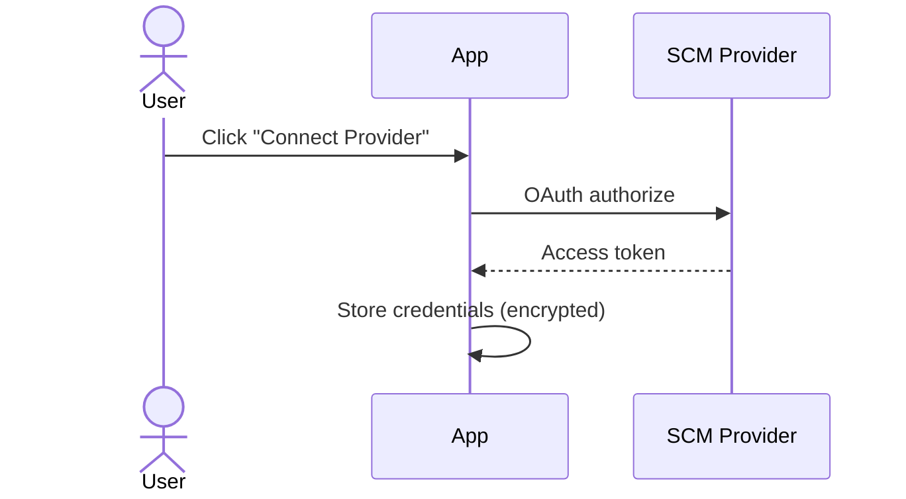
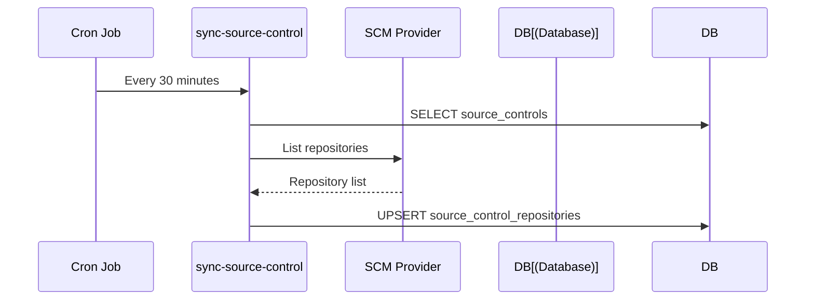
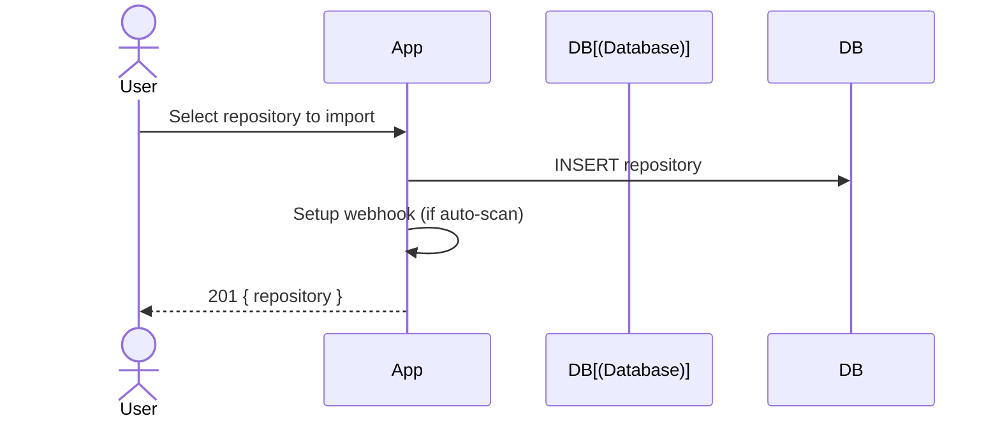
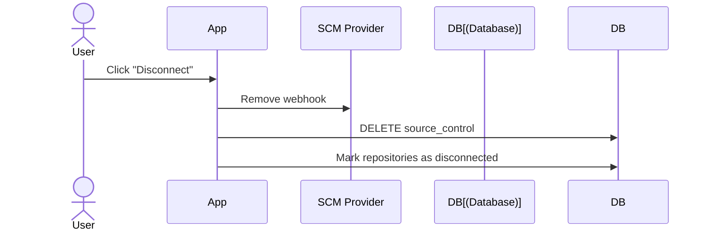

# Source Control Integration

## Supported Providers

| Provider | OAuth | Webhooks | PR Comments | Commit Status |
|----------|:-----:|:--------:|:-----------:|:-------------:|
| GitHub | ✅ | ✅ | ✅ | ✅ |
| GitLab | ✅ | ✅ | ✅ | ✅ |
| Gitea | ✅ | ✅ | ✅ | ✅ |

## Connection Flow

## Repository Sync

## Import Repository

## Disconnect Provider

