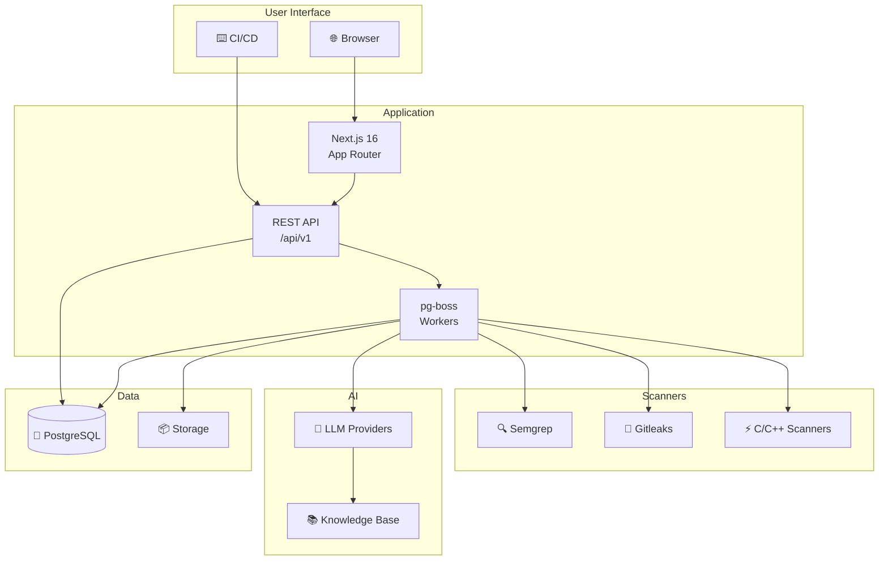
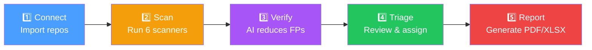

# Welcome to SAST Integration

> Multi-scanner static application security testing platform with AI-powered false positive reduction.

SAST Integration unifies 6 scanner engines with AI-powered verification to deliver actionable security findings with minimal false positives. Built for teams that need comprehensive code security analysis without the noise.

## Key Capabilities

| Capability | Description | Details |
|------------|-------------|---------|
| **6 Scanner Engines** | Multi-language security analysis | Semgrep (30+ languages), Gitleaks (secrets), Flawfinder/Cppcheck/Clang-Tidy/GCC FanAnalyzer (C/C++) |
| **AI Verification** | LLM-powered false positive reduction | Primary + fallback model chain, knowledge-base context enrichment |
| **Source Control** | SCM integration | GitHub, GitLab, Gitea — auto-sync, webhooks, PR analysis |
| **Knowledge Base** | NVD context enrichment | NVD feed sync (every 6h) |
| **RBAC** | Role-based access control | 4 roles, 39 permissions, workspace-scoped |
| **Quality Gates** | Automated scan evaluation | Configurable fail rules, commit status integration |
| **Reporting** | PDF/XLSX/CSV exports | Findings list, scan summaries, workspace overviews |
| **Scanning** | Scheduled + on-demand scans | Cron-based schedules, PR-triggered, CI/CD upload |

## Architecture Overview



## Tech Stack

| Layer | Technology | Version |
|-------|-----------|---------|
| Framework | Next.js (App Router) | 16.2.9 |
| Language | TypeScript (strict) | 5 |
| UI | Ant Design | 6 |
| ORM | Drizzle ORM | 0.45.2 |
| Database | PostgreSQL | 16 |
| Queue | pg-boss | — |
| Auth | JWT (jose) + bcryptjs | — |
| Validation | Zod | — |
| Testing | Vitest + Playwright | — |
| Container | Docker (Alpine Linux) | — |
| Package Manager | pnpm | 10+ |

## How It Works



1. **Connect** — Import repositories from GitHub, GitLab, or Gitea
2. **Scan** — Run multi-engine static analysis with 6 scanners
3. **Verify** — AI verifies findings and reduces false positives
4. **Triage** — Review, assign, resolve, or dismiss findings
5. **Report** — Generate PDF/XLSX security reports

## Quick Start

```bash
# Clone and install
git clone https://github.com/your-org/sast-integration.git
cd sast-integration
pnpm install

# Configure environment
cp .env.example .env
# Edit .env — set DATABASE_URL, JWT_SECRET, OWNER_EMAIL, OWNER_PASSWORD

# Setup database
pnpm db:reset

# Start development server
pnpm dev
```

Access at **http://localhost:3000** — sign up with the `OWNER_EMAIL` from your `.env`.

## Quick Links

| Section | Description |
|---------|-------------|
| [Installation](getting-started/installation.md) | Environment setup and installation |
| [First Scan](getting-started/first-scan.md) | Run your first security scan |
| [Architecture](architecture/overview.md) | System design and technical overview |
| [Features](features/scans.md) | Scan management and capabilities |
| [API Reference](reference/api-overview.md) | REST API documentation |
| [Deployment](../../DEPLOYMENT.md) | Production deployment guide |
