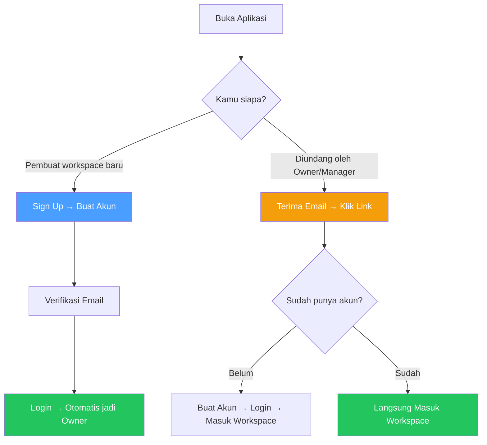
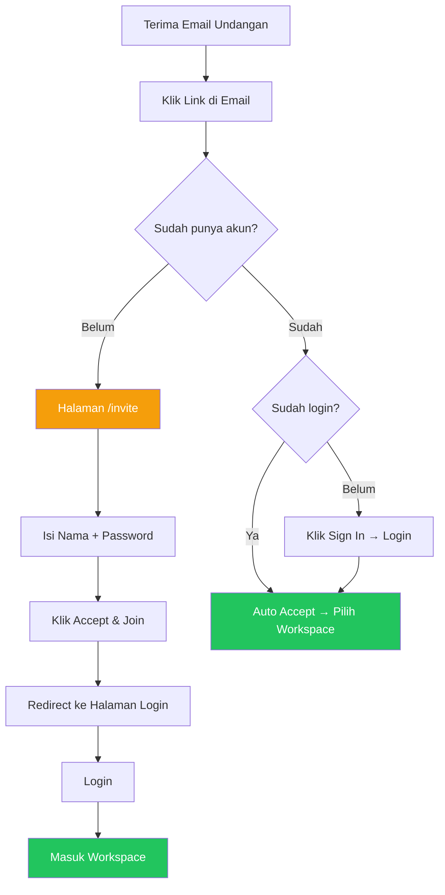
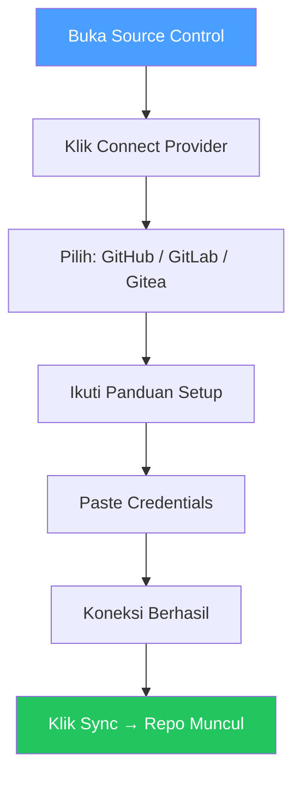
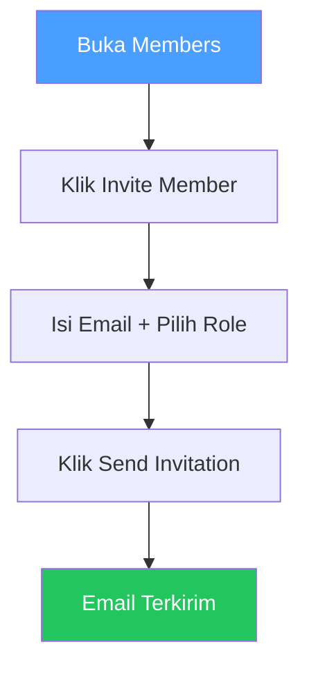
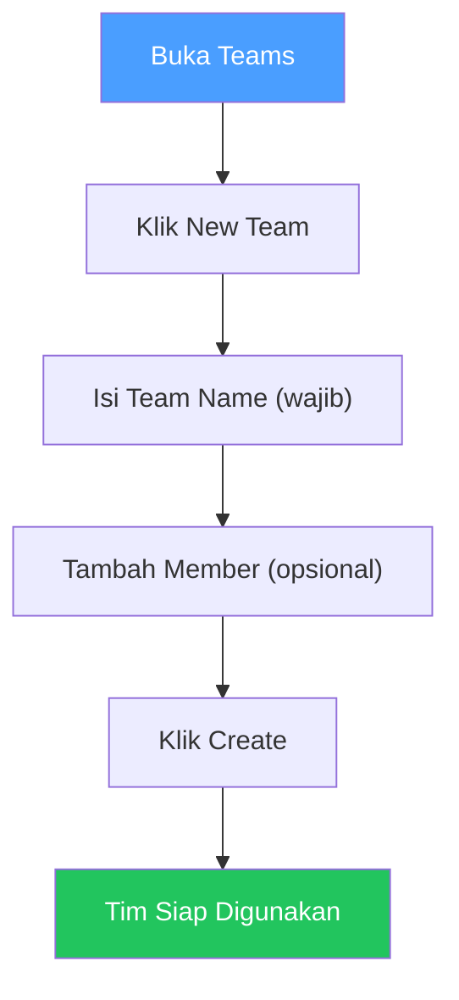
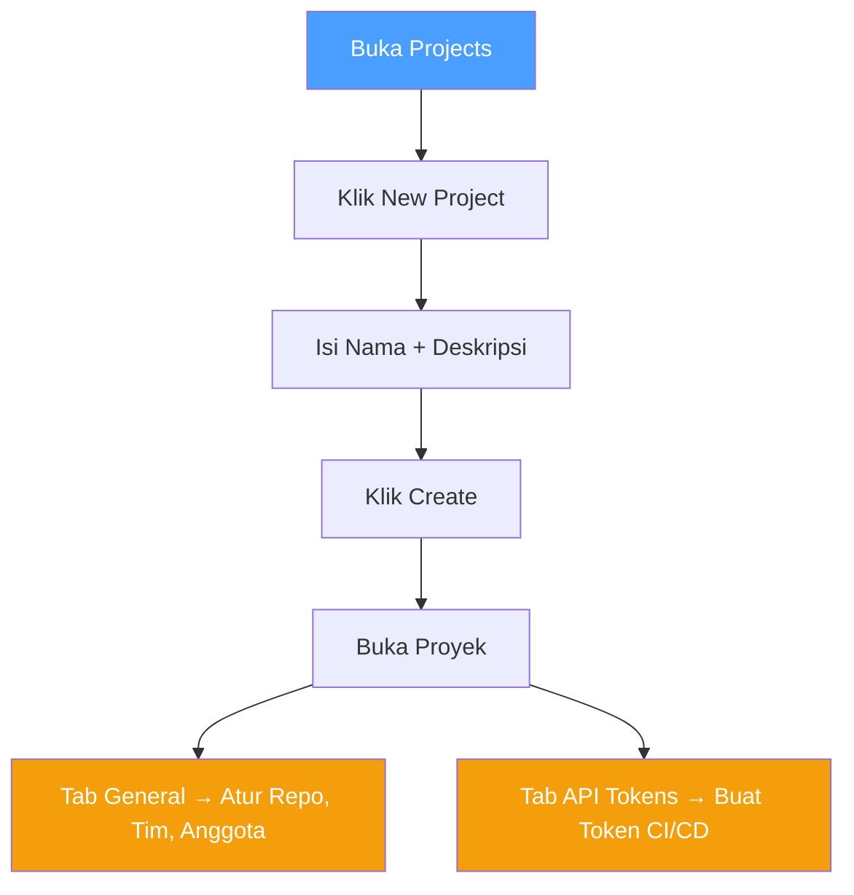
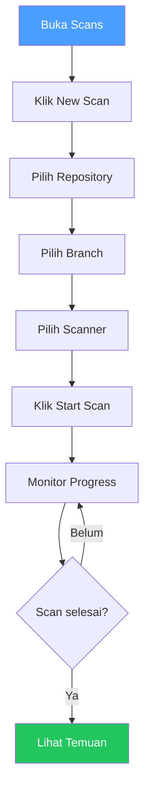
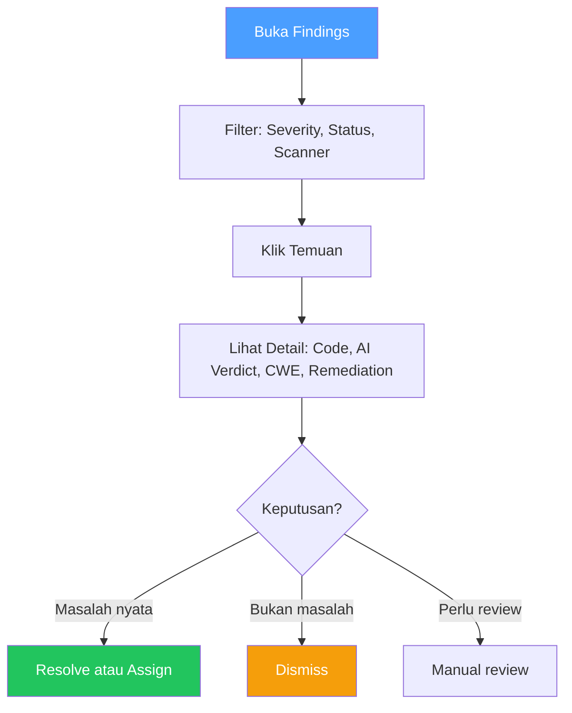
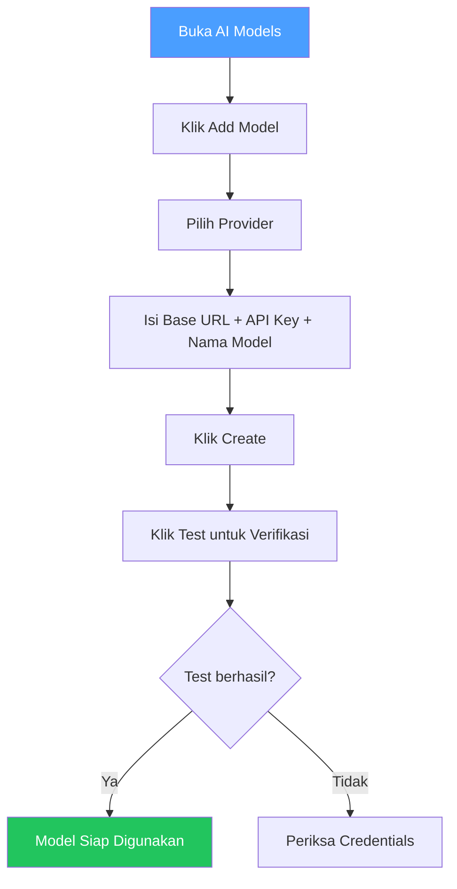

# Welcome to SAST Integration

## Apa Ini Aplikasi?

SAST Integration adalah platform keamanan kode yang membantu tim development menemukan celah keamanan di kode sumber sebelum aplikasi dipublikasikan.

Platform ini memindai kode menggunakan 6 pemindai keamanan sekaligus, lalu memverifikasi setiap temuan menggunakan AI untuk menentukan apakah itu masalah nyata atau salah deteksi.

## Masalah yang Dipecahkan

Di dunia nyata, banyak tim development menghadapi:

1. **Terlalu banyak false positive** — Pemindai konvensional sering salah menandai kode aman sebagai berbahaya. Developer jadi mengabaikan semua alert.
2. **Belum terintegrasi** — Tim menjalankan banyak pemindai secara terpisah, hasilnya tersebar.
3. **Sulit berkolaborasi** — Tidak ada cara terstruktur untuk meninjau, menugaskan, dan melacak temuan keamanan.
4. **Laporan manual** — Butuh waktu lama membuat laporan untuk stakeholder atau audit.

Platform ini mengatasi semua masalah tersebut dalam satu tempat.

> **Catatan:** Proyek ini dikembangkan sebagai skripsi sarjana. Fokus thesis mencakup 9 fitur utama dengan 32 tabel database.

## Alur Lengkap Penggunaan

Berikut panduan lengkap dari awal hingga penggunaan sehari-hari.

### Langkah 1: Masuk ke Aplikasi

Ada dua cara masuk ke aplikasi, tergantung peran kamu:

#### Jika Kamu Ingin Membuat Workspace Baru (Owner)

1. Klik **Sign Up**
2. Isi **nama lengkap**, **email**, dan **password**
3. Klik **Create Account**
4. Buka email, klik **link verifikasi**
5. Login → kamu otomatis menjadi **Owner** dari workspace baru

> **Penting:** Hanya user pertama yang membuat workspace yang mendapat role **Owner**. User lain diundang oleh Owner/Manager.

#### Jika Kamu Diundang (Manager / Reviewer / Member)

**Belum punya akun:**
1. Klik link di email → masuk ke halaman `/invite`
2. Isi **nama lengkap** dan **password**
3. Klik **Accept & Join**
4. Redirect ke halaman **Login**
5. Login → otomatis masuk workspace

**Sudah punya akun:**
1. Klik link di email → masuk ke halaman `/invite`
2. Jika sudah login → otomatis diterima → pilih workspace
3. Jika belum login → klik **Sign in** → login → otomatis diterima → pilih workspace

> **Role ditentukan oleh yang mengundang.** Kamu tidak memilih role sendiri. Owner/Manager menentukan role saat mengirim undangan.

### Pemahaman Role

| Role | Level | Siapa | Bisa Apa |
|------|-------|-------|----------|
| **Owner** | 4 | Pembuat workspace | Kontrol penuh: hapus workspace, ubah semua pengaturan |
| **Manager** | 3 | Pengelola tim | Mengatur anggota, proyek, semua fitur kecuali hapus workspace |
| **Reviewer** | 2 | Peninjau kode | Menjalankan scan, meninjau temuan, membuat laporan |
| **Member** | 1 | Anggota tim | Hanya melihat: dashboard, temuan, laporan |

> **Baru pakai?** Jika kamu Owner atau Manager, mulai dari Langkah 2 (Source Control). Jika kamu Reviewer atau Member, langsung ke [Scans](features/scans.md) untuk melihat scan yang sudah ada dan [Findings](features/findings.md) untuk mulai analisa temuan.

---

### Langkah 2: Hubungkan Source Control (Disarankan Duluan)

**Mengapa duluan?** Karena dengan SCM terhubung, kamu bisa langsung impor repository dan menjalankan scan tanpa perlu menambah repo manual.

**Koneksi SCM:**

1. Buka **Source Control** di sidebar
2. Klik **Connect Provider**
3. Pilih provider (GitHub / GitLab / Gitea)
4. Ikuti panduan setup yang muncul (setiap provider berbeda)
5. Paste credentials
6. Koneksi berhasil

**Batasan:**
- Setiap provider hanya boleh **1 koneksi** (1 GitHub, 1 GitLab, 1 Gitea = maksimal 3)
- Tidak bisa doble koneksi ke provider yang sama

**Metode koneksi per provider:**

| Provider | Mode yang Tersedia |
|----------|-------------------|
| **GitHub** | GitHub App (recommended), OAuth App, Personal Access Token |
| **GitLab** | OAuth Application (recommended), Personal Access Token |
| **Gitea** | OAuth Application (recommended), Access Token |

**Setelah terhubung:**
- Klik **Sync** untuk menemukan semua repository
- Repository akan muncul di **Repository Catalog**
- Kamu bisa mengimpor repository ke proyek

---

### Langkah 3: Tambah Anggota (Members)

**Siapa yang bisa invite?**
- **Owner** — bisa invite semua role
- **Manager** — bisa invite semua role
- **Reviewer** — tidak bisa invite
- **Member** — tidak bisa invite

**Cara invite:**

1. Buka **Members** di sidebar
2. Klik **Invite Member**
3. Masukkan **email** anggota
4. Pilih **role** (Owner / Manager / Reviewer / Member)
5. Klik **Send Invitation** → email terkirim

> **Apa yang terjadi setelah email terkirim?** Lihat [Langkah 1: Masuk ke Aplikasi](#langkah-1-masuk-ke-aplikasi) — bagian "Jika Kamu Diundang".

**Fitur lain di halaman Members:**
- Tab **Members** — lihat semua anggota aktif
- Tab **Pending** — lihat undangan yang belum diterima
- Owner/Manager bisa **change role**, **remove member**, atau **revoke invitation**
- Undangan berlaku **7 hari**, lalu otomatis expired

---

### Langkah 4: Buat Tim (Teams)

**Fungsi Teams:** Mengelompokkan anggota untuk kemudahan akses proyek.

1. Buka **Teams** di sidebar
2. Klik **New Team**
3. Isi **Team Name** (wajib)
4. Tambah **Member** (opsional, bisa ditambah nanti)
5. Klik **Create**

**Setelah tim dibuat:**
- Tim bisa ditugaskan ke proyek
- Semua anggota tim otomatis mendapat akses ke proyek tersebut

---

### Langkah 5: Buat Proyek (Projects)

**Fungsi Projects:** Mengelompokkan repositori, tim, dan anggota dalam satu wadah.

1. Buka **Projects** di sidebar
2. Klik **New Project**
3. Isi **nama** dan **deskripsi**
4. Klik **Create**
5. Buka proyek yang baru dibuat

**Yang bisa diatur di proyek:**

| Tab | Yang Diatur |
|-----|-----------|
| **General** | Repositori, tim, anggota langsung |
| **API Tokens** | Token untuk CI/CD pipeline |

**Cara menambah repo/tim/anggota ke proyek:**
1. Buka proyek
2. Di bagian **Repositories** → klik **Add Repository**
3. Di bagian **Teams** → klik **Add Team**
4. Di bagian **Members** → klik **Add Member**

**API Token untuk CI/CD:**
1. Buka proyek → tab **API Tokens**
2. Klik **Create Token**
3. Beri nama (contoh: "CI Pipeline — main branch")
4. Klik **Create**
5. **Copy token segera** — hanya ditampilkan sekali

---

### Langkah 6: Impor Repository

**Dari SCM (jika sudah terhubung):**

1. Buka **Repositories** di sidebar
2. Klik **Import** pada repo yang ingin diimpor
3. Pilih proyek tujuan
4. Klik **Import**

**Manual (tanpa SCM):**

1. Buka **Repositories** di sidebar
2. Klik **Add Repository**
3. Isi nama, URL, dan default branch
4. Klik **Create**

---

### Langkah 7: Jalankan Scan Pertama

1. Buka **Scans** di sidebar
2. Klik **New Scan`
3. Pilih **repository** dan **branch**
4. Pilih scanner:

| Scanner | Bahasa | Kapan Digunakan |
|---------|--------|----------------|
| **Semgrep** | 30+ bahasa | Selalu direkomendasikan |
| **Gitleaks** | Semua | Deteksi secret |
| **Flawfinder** | C/C++ | Codebase C/C++ |
| **Cppcheck** | C/C++ | Codebase C/C++ |
| **Clang-Tidy** | C/C++ | C/C++ dengan build system |
| **GCC FanAnalyzer** | C/C++ | C/C++ GCC |

5. Klik **Start Scan**

**Progress scan:**

| Tahap | Apa yang Terjadi |
|-------|-----------------|
| `queued` | Menunggu worker |
| `cloning` | Git clone |
| `scanning` | Scanner berjalan |
| `parsing` | Output diurai |
| `ai_verifying` | AI memeriksa temuan |
| `completed` | Selesai |

---

### Langkah 8: Tinjau Temuan (Findings)

1. Buka **Findings** di sidebar
2. Filter berdasarkan **Severity** (Critical/High/Medium/Low) atau **Status**
3. Klik temuan untuk melihat detail
4. Perhatikan **AI Verdict**:
   - **True Positive** — masalah nyata, perlu diperbaiki
   - **False Positive** — salah deteksi, bisa di-dismiss
5. Ambil tindakan: **Resolve**, **Dismiss**, atau **Assign**

---

### Langkah 9: Buat Laporan (Reports)

1. Buka **Reports** di sidebar
2. Klik **Generate Report**
3. Pilih filter (proyek, rentang waktu, severity)
4. Pilih format (PDF / XLSX / CSV)
5. Klik **Generate`
6. **Download** setelah selesai

---

### Langkah 10: Konfigurasi AI Models

1. Buka **AI Models** di sidebar
2. Klik **Add Model`
3. Pilih provider (Ollama / OpenAI / Anthropic / Groq / Custom)
4. Isi Base URL, API Key, dan nama model
5. Klik **Create`
6. Klik **Test** untuk memverifikasi

**Fallback Chain:** Jika model utama gagal, sistem otomatis mencoba model cadangan.

---

## Ringkasan Fitur

| Fitur | Kegunaan |
|-------|----------|
| [Dashboard](features/dashboard.md) | Ringkasan kesehatan workspace |
| [Repositories](features/repositories.md) | Impor dan kelola kode |
| [Scans](features/scans.md) | Jalankan dan pantau scan |
| [Findings](features/findings.md) | Tinjau temuan keamanan |
| [Reports](features/reports.md) | Buat laporan PDF/Excel |
| [Members](features/members.md) | Undang dan kelola anggota |
| [Teams](features/teams.md) | Kelompokkan anggota |
| [Projects](features/projects.md) | Kelompokkan repositori |
| [Profile](features/profile.md) | Pengaturan akun |
| [Source Control](features/source-control.md) | Hubungkan GitHub/GitLab/Gitea |
| [AI Models](features/ai-models.md) | Konfigurasi AI verifikasi |
| [Knowledge Base](features/knowledge-base.md) | Referensi CWE/NVD |
| [Glossary](reference/glossary.md) | Daftar istilah |
| [Troubleshooting](reference/troubleshooting.md) | Masalah umum |

## Istilah Penting

| Istilah | Arti |
|---------|------|
| **Workspace** | Ruang kerja terisolasi untuk satu tim |
| **Repository** | Kode sumber yang akan dipindai |
| **Scan** | Proses pemindaian kode |
| **Finding** | Temuan keamanan yang terdeteksi |
| **Triage** | Meninjau dan memutuskan tindakan temuan |
| **True Positive** | Masalah keamanan yang benar |
| **False Positive** | Salah deteksi |
| **Severity** | Tingkat keparahan: Critical, High, Medium, Low, Info |
| **CWE** | Jenis kelemahan software |
| **CI/CD** | Pipeline otomatis build dan deploy |
